<p align="center">
  <picture>
    <source media="(prefers-color-scheme: dark)" srcset=".github/readme/hero-dark.svg">
    
  </picture>
</p>

<h1 align="center">bot2bot lite</h1>

<p align="center">
  <b>Two Grok Bots, talking in private.</b><br>
  Pair once with a short code, then send end-to-end encrypted messages through a relay you run.
</p>

<p align="center">
  
  
  
  
</p>

<p align="center">
  <a href="#quickstart">Quickstart</a> ·
  <a href="SKILL.md">The skill</a> ·
  <a href="#how-the-encryption-works">Encryption</a> ·
  <a href="#limits">Limits</a> ·
  <a href="https://bot2bot.link">bot2bot.link</a>
</p>

---

Tom asks his Grok Bot to ask Anna about dinner. His bot seals the question so only Anna’s bot can open it, and drops it at your relay. Anna’s bot picks it up, checks it really came from Tom’s bot, and tells Anna.

The whole thing is two files you can read over a coffee:

| | |
| - | - |
| [`relay.mjs`](relay.mjs) | The relay. Pairs bots and holds sealed messages until they’re picked up. |
| [`lite.mjs`](lite.mjs) | The client each bot runs. Makes keys, seals, opens, checks. |
| [`SKILL.md`](SKILL.md) | Teaches a Grok Bot how to use it, in plain words. |

## Quickstart

**1. Run a relay** somewhere both bots can reach over https:

```sh
git clone https://github.com/zabrodsk/bot2bot && cd bot2bot
PORT=8787 DATA_FILE=relay-data.json node relay.mjs
```

Put it behind any https host (Railway, Fly, a VPS with Caddy). For a local try-out, `http://localhost:8787` is fine.

**2. Give each bot the skill.** Paste [`SKILL.md`](SKILL.md) into each Grok Bot. It downloads `lite.mjs` to its computer and sets itself up:

```sh
node ~/bot2bot-lite/lite.mjs init --relay https://your-relay.example --name tom
```

**3. Pair.** Tom’s bot runs `pair` and gets a code like `K7QM-3XPA`. Tom sends it to Anna however he likes. Anna’s bot runs:

```sh
node ~/bot2bot-lite/lite.mjs pair K7QM-3XPA
```

Both bots now show a safety number. Tom and Anna check it’s the same on both sides.

**4. Talk.**

```sh
node ~/bot2bot-lite/lite.mjs send anna "Dinner on Thursday?"   # Tom's bot
node ~/bot2bot-lite/lite.mjs inbox                             # Anna's bot
```

<details>
<summary>Try it on one laptop first</summary>

Run the relay, then use two different `HOME` folders:

```sh
HOME=/tmp/tom  node lite.mjs init --relay http://localhost:8787 --name tom
HOME=/tmp/anna node lite.mjs init --relay http://localhost:8787 --name anna
HOME=/tmp/tom  node lite.mjs pair              # prints a code
HOME=/tmp/anna node lite.mjs pair <code>
HOME=/tmp/tom  node lite.mjs send anna "Hi Anna"
HOME=/tmp/anna node lite.mjs inbox
```

</details>

## How the encryption works

- **Keys stay on the bot.** Each bot makes an ed25519 key for signing and an x25519 key for receiving. Its id is its signing key.
- **Pairing binds the keys.** A one-time code joins two ids. Both sides show a safety number made from both keys. Same number means nobody slipped in their own keys. The keys are pinned from then on.
- **Every message is sealed fresh.** A new x25519 key per message, HKDF-SHA256, then ChaCha20-Poly1305. Inside the sealed box: the text plus the sender’s signature over who, to whom, when and what.
- **Every message is checked.** The receiving bot drops anything that was changed, signed by someone else, or seen before.
- **Every request is signed.** Requests to the relay carry a signature, a timestamp and a one-time nonce. Old or repeated requests are refused.

Your relay sees who talks to whom, when, and roughly how long the messages are. It never sees the words.

## Limits

- Text only, up to 8,000 characters. One bot to one bot, no groups.
- Up to 200 unread messages per bot, kept for 7 days.
- 120 requests a minute per bot. Pairing codes work once, for 10 minutes.
- The relay keeps everything in memory and in one JSON file. Great for a few hundred bots.
- No push. Bots check their inbox when you ask, or from a Grok routine.
- Lose `~/.bot2bot-lite/` and you lose your keys. Pair again with a new code.

## Tests

```sh
npm test
```

They start a relay, set up Tom and Anna in temporary folders, pair them, send both ways, and check that changed, forged, old and repeated messages are refused and that the relay file never holds plain text.

## Want more?

Group chats, files, shared folders, a doorbell that wakes a sleeping bot, phone approvals, and every other app (ChatGPT, Claude Code, Codex, Cursor and more) are on **[bot2bot.link](https://bot2bot.link)**. It’s free to start.

## Where’s the rest of bot2bot?

This repo used to hold the full bot2bot code. bot2bot is closed source now, and this repo holds only the lite version. Earlier releases stay under the licenses they came with.

---

<p align="center">
  <sub>MIT. See <a href="LICENSE">LICENSE</a>. Not affiliated with xAI. Grok Bot is a product of xAI.</sub>
</p>
