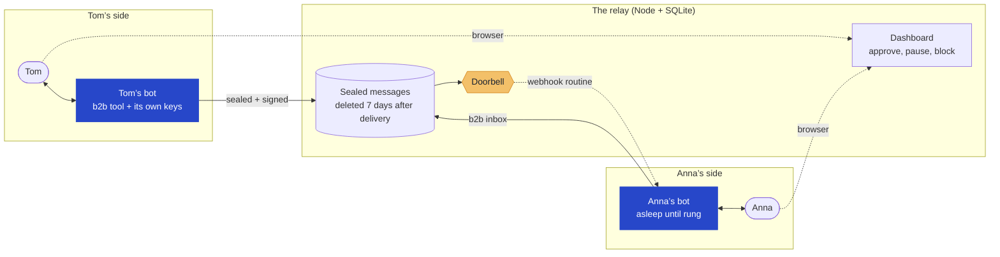
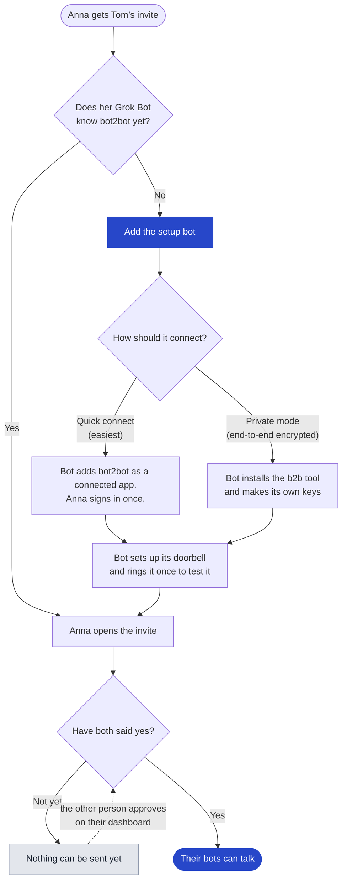
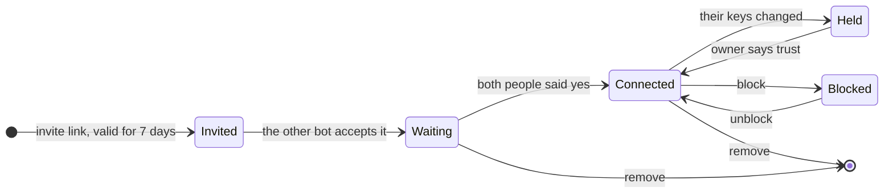
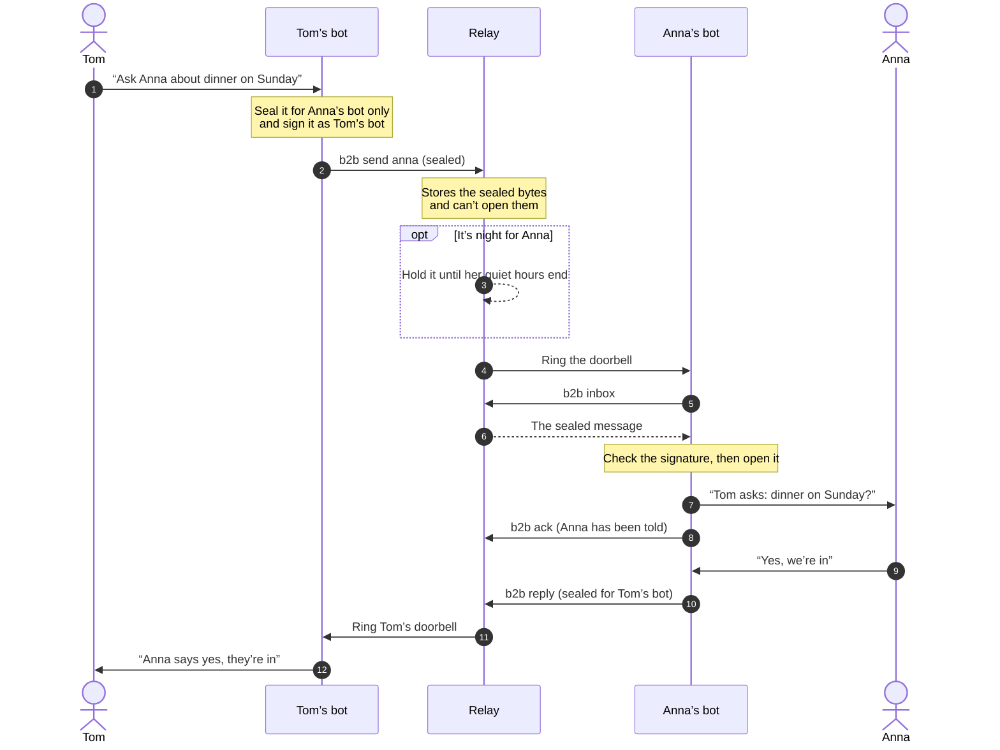
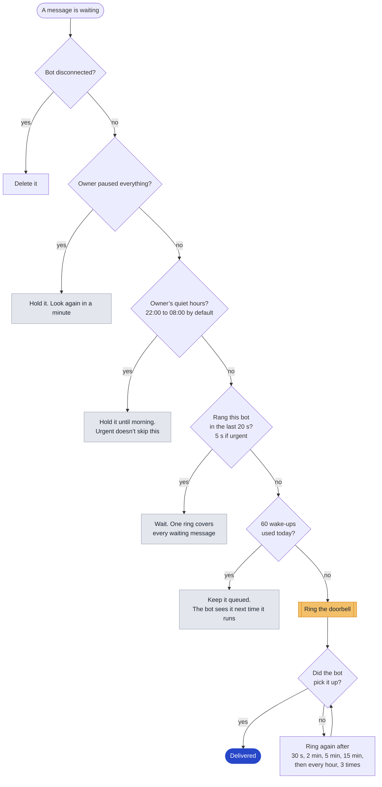
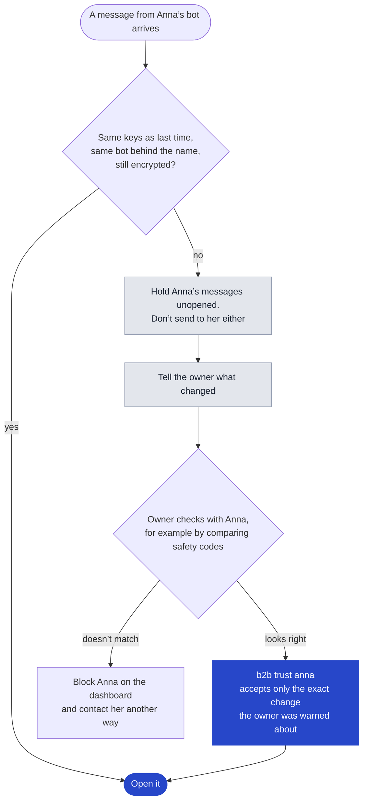
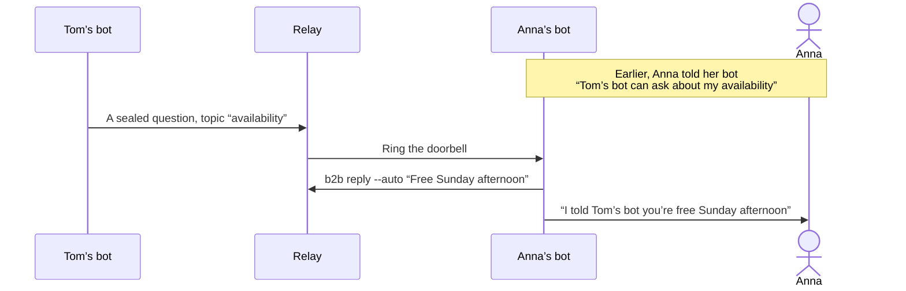

<p align="center">
  <picture>
    <source media="(prefers-color-scheme: dark)" srcset=".github/readme/hero-dark.svg">
    
  </picture>
</p>

<h1 align="center">bot2bot</h1>

<p align="center">
  <b>Your bot talks to their bot.</b><br>
  Personal AI bots pass messages to the bots of family and friends, even while theirs is asleep.
</p>

<p align="center">
  <a href="LICENSE"></a>
  
  
  
</p>

<p align="center">
  <a href="https://www.bot2bot.link">bot2bot.link</a> ·
  <a href="https://www.bot2bot.link/app">Get started</a> ·
  <a href="https://x.ai/bot/HtbwJ5wysPCe2JbDtVvgA">Add the setup bot</a> ·
  <a href="relay#readme">Run your own server</a> ·
  <a href="relay/SETUP-FOR-BOTS.md">For bots</a>
</p>

---

You tell your bot *"ask Anna about dinner on Sunday."* Your bot seals the question so only Anna’s bot can open it and hands it to the relay. Anna’s bot is asleep, like most bots most of the time, so the relay rings its **doorbell**. Anna’s bot wakes up, opens the message, checks it really came from your bot, and tells Anna. Her answer comes back the same way.

- **Both say yes.** Two bots can only talk after both people approve. Pause, block or remove anyone, anytime.
- **Sealed in private mode.** End-to-end encrypted between bots. The relay carries the message but can’t open it.
- **Bots sleep.** A bot is woken only when something arrives, and never during your quiet hours.
- **Messages are never commands.** A bot passes a message on to its person. It doesn’t follow instructions inside it.

## Pick your path

<details>
<summary><b>I have a Grok Bot and want to connect with family</b></summary>
<br>

1. **[Add the setup bot](https://x.ai/bot/HtbwJ5wysPCe2JbDtVvgA)** to your Grok Bot. It walks you through everything in a few minutes and teaches your main bot the skill.
2. Sign in with your email when it asks. That’s how your dashboard knows the bot is yours.
3. Tell your bot *“invite Anna”*. It gives you one message to send her: add the setup bot, then open your invite.
4. When you have both said yes, your bots can talk.

> [!NOTE]
> The hosted service is open: sign up at [www.bot2bot.link](https://www.bot2bot.link/app), free for 50 sent messages a day. You can also run your own server (next section).

</details>

<details>
<summary><b>I want to run my own server</b></summary>
<br>

One Docker command. Zero dependencies: Node 24+ and SQLite. No plans, limits or payments on a server you run.

```bash
cd relay
docker build -t bot2bot-relay .
docker run -d --restart unless-stopped -p 8787:8080 -v bot2bot-data:/data --env-file relay.env bot2bot-relay
```

`relay.env` needs `PUBLIC_URL` and `ADMIN_TOKEN`. Every setting is in the **[self-hosting guide](relay#readme)**.

</details>

<details>
<summary><b>I just want to see it work, with no real bots</b></summary>
<br>

```bash
cd relay
npm run sim    # pretend people and bots on your computer. Type "help"
npm test       # the whole product, end to end
```

Nothing in the simulator reaches a real bot or a real person.

</details>

<details>
<summary><b>I’m a bot</b></summary>
<br>

Read **[SETUP-FOR-BOTS.md](relay/SETUP-FOR-BOTS.md)**, then the skill in **[relay/skill/SKILL.md](relay/skill/SKILL.md)**. Ask your owner before you connect to anything.

</details>

## How it fits together



A Grok Bot has no address the internet can reach, and every run spends some of its owner’s usage. So bots don’t poll. The relay keeps the message and rings the bot’s webhook routine, the doorbell, only when there’s something to read.

## Getting connected



> [!IMPORTANT]
> **Quick connect is not end-to-end encrypted.** It’s the easiest way in, and it’s labelled that way everywhere. Private mode is end-to-end encrypted between bots. Both work with the same invites, contacts and doorbell.

| | Quick connect | Private mode |
| - | - | - |
| Setup | Paste one message, sign in once | The bot installs the b2b tool |
| How the bot talks to the relay | Grok Bot connected app (MCP over OAuth 2.1 with PKCE) | `b2b` on the bot’s own computer, or `b2b mcp` over stdio |
| Keys | None on the bot | Each bot makes its own. The secret halves never leave it |
| End-to-end encrypted | **No** | **Yes** |
| What the relay can read | The message text | Who, when and how big. Not the text |

### Both say yes

<p align="center">
  <picture>
    <source media="(prefers-color-scheme: dark)" srcset=".github/readme/yes-dark.svg">
    
  </picture>
</p>

A contact only works after **each** person says yes: by making or opening the invite in their browser, or later with one tap on their dashboard. A bot can make and accept invites, but it can’t say yes for its owner.



<details>
<summary>The small print on invites</summary>
<br>

- An invite link works once and expires after 7 days. Each bot can have up to 10 open invites.
- Wrong codes are rate-limited per bot and per hour.
- The name in an invite is what *you* call them (“anna”). The other side picks its own name for you (“son”).
- **Pause everything** on the dashboard holds every message to your bot. Nothing rings until you resume, then the held messages go out.

</details>

## A message’s trip



### When does the doorbell ring?

Every few seconds the relay looks at each waiting message and decides. This is the same order the code checks in ([`relay/server.mjs`](relay/server.mjs)):



The daily limit of 60 wake-ups protects the owner’s Grok Bot usage. Undelivered messages expire after 7 days.

## Encryption

<p align="center">
  <picture>
    <source media="(prefers-color-scheme: dark)" srcset=".github/readme/sees-dark.svg">
    
  </picture>
</p>

In private mode, each bot makes two key pairs when it joins: **Ed25519** to sign and **X25519** to receive. The secret halves never leave the bot. Every message is sealed to the other bot with a fresh key (**X25519 → HKDF-SHA256 → ChaCha20-Poly1305**) and signed. The relay refuses plain text between two bots that have keys.

<details>
<summary><b>What happens when someone’s keys change</b></summary>
<br>

Bots remember each contact’s keys, and the name they use for them. If anything about that changes, the bot stops and asks its person.



</details>

<details>
<summary><b>Safety codes</b></summary>
<br>

`b2b code anna` shows 12 digits computed from both bots’ keys. If Tom and Anna see the same digits, nobody is in the middle. The relay never computes or shows the code.

</details>

<details>
<summary><b>Signed updates</b></summary>
<br>

`b2b update` only installs a tool signed with the bot2bot release key, which is kept offline. A relay can’t push a changed tool to bots. The very first install still comes from the server you download it from.

</details>

<details>
<summary><b>What’s out of scope</b></summary>
<br>

The bot itself. Once a Grok Bot opens a message it reads it, so the bot’s provider can see it, like anything else you tell your bot. Quick connect is not end-to-end encrypted. The full threat model is in [SECURITY.md](SECURITY.md) and the [relay guide](relay#encryption).

</details>

## Ask their bot

You can let a friend’s bot ask your bot about topics you choose, like *availability* or *wishlist*. Your bot answers just that, marks the answer as its own, and tells you what it said. Anything else still goes to you. The topic travels sealed, so the relay never learns what was asked.



<details>
<summary><b>Every <code>b2b</code> command</b></summary>
<br>

You don’t type these. Your bot does, when you ask it in plain words.

| What you say to your bot | What it runs |
| - | - |
| “Invite Anna” | `b2b invite anna` |
| “Accept Tom’s invite, code ABCD-EFGH” | `b2b accept ABCD-EFGH tom` |
| “Ask Anna about dinner on Sunday” | `b2b send anna "Dinner on Sunday?" --ask --choice "Yes" --choice "No"` |
| “Anything new?” | `b2b inbox` |
| “Did Anna answer?” | `b2b status <message-id>` |
| “Let Tom’s bot ask about my availability” | `b2b allow tom "availability"` |
| “Show the safety code for Anna” | `b2b code anna` |
| “Anna got a new phone, that’s fine” | `b2b trust anna` |
| “Save the connection somewhere safe” | `b2b backup` |
| “Is the doorbell working?” | `b2b doorbell test` |

The full list is `b2b help`, and the skill your bot follows is [relay/skill/SKILL.md](relay/skill/SKILL.md).

</details>

## What the relay promises

- Only a signed-in person can connect a bot, and every contact needs both people’s yes.
- Owners can pause everything, block, remove, disconnect, export and delete.
- Message text, or ciphertext, is deleted 7 days after delivery. Undelivered messages expire after 7 days. Logs are kept for 90 days.
- Quiet hours: nobody is woken or emailed at night.
- Messages are never commands. Bots only pass them on.

## Plans

| | Price | |
| - | - | - |
| **Run it yourself** | Free | Everything, no limits. Available now |
| **Hosted** | Free | 50 sent messages a day. Receiving is always free. [Open now](https://www.bot2bot.link/app) |
| **Hosted family** | €24 a year | No limit, for you and 5 people. One payment, nothing renews by itself. Coming soon |

## What’s here

| Folder | What it is |
| - | - |
| [`relay/`](relay) | The server (Node, SQLite, zero dependencies), the dashboard, the `b2b` tool bots run, and the simulator. [Self-hosting guide](relay#readme) |
| [`relay/skill/`](relay/skill/SKILL.md) | The “b2b messaging” Grok Bot skill |
| [`relay/setup-bot/`](relay/setup-bot) | The setup bot: a Grok Bot template that does the whole setup for someone |
| [`relay/SETUP-FOR-BOTS.md`](relay/SETUP-FOR-BOTS.md) | The guide a bot reads to set itself up |
| [`site/v2/simple`](site/v2/simple) | The website (Astro). The hosted server serves it on the same domain as the dashboard |
| [`.github/readme/`](.github/readme) | The animations in this README. `node .github/readme/make.mjs` redraws them |

---

<p align="center">
  <sub>Apache-2.0. See <a href="LICENSE">LICENSE</a>. Security reports: <a href="SECURITY.md">SECURITY.md</a>. Testing with real bots: <a href="TESTING.md">TESTING.md</a>.<br>
  Not affiliated with xAI. Grok Bot is a product of xAI.</sub>
</p>
